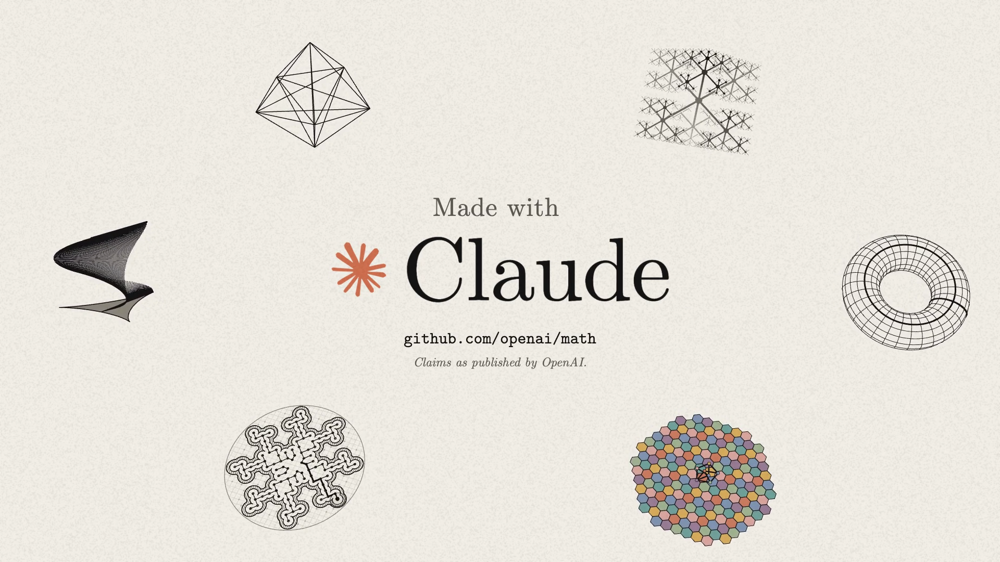

# hold-my-tokens



A hype film about OpenAI's math release, made entirely in code by Claude. Remotion + three.js.

```bash
npm install
pip install -r requirements.txt
./preview.sh   # 360p
./render.sh    # 1080p60
```

Music not included. Put a track at `public/audio.wav`.

[WORKFLOW.md](WORKFLOW.md) · [FACTS.md](FACTS.md)

Not affiliated with OpenAI or Anthropic.
